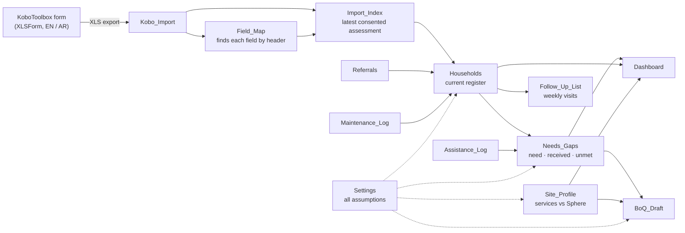

# IDP Site Needs and Gap Tracker

This project pairs two tools for displacement sites:

- **A bilingual KoboToolbox household assessment form** (XLSForm, English and Arabic).
- **A formula-driven Excel tracker** that turns the form's export into a site-management picture.

The tracker answers four questions:

1. What is the current situation of each household? It keeps one current record per household.
2. What does each household still need?
3. Which sites fall below basic service reference values?
4. Which households need a visit this week, and why?

> [!IMPORTANT]
> **This is a self-directed practice project built entirely on synthetic data.**
> - **No real data:** no real household, person, site or organisation appears in the files. "Agency A–D" and "Community donation" are fictional providers, and all dates belong to an invented winter scenario.
> - **Not deployed:** the form has not been deployed for operational data collection.
> - **Indicative values only:** the Sphere values are references for practice, planning ratios are illustrative, and unit costs are placeholders, not market prices.


---

## Contents

- [Why this project exists](#why-this-project-exists)
- [Repository contents](#repository-contents)
- [How it works](#how-it-works)
- [Part 1 — The household assessment form](#part-1--the-household-assessment-form)
- [Part 2 — The tracker workbook](#part-2--the-tracker-workbook)
- [Results from the synthetic scenario](#results-from-the-synthetic-scenario)
- [Configuration](#configuration)
- [Getting started](#getting-started)
- [Technical notes and verification](#technical-notes-and-verification)
- [Limitations](#limitations)
- [Standards and references](#standards-and-references)
- [Author](#author)

---

## Why this project exists

The project is shaped by informal support to displaced families living in school shelters in Rafah in 2024. Two problems stood out there:

- **Repeated questions with no visible result.** Households were asked for the same information again and again, without seeing what happened next.
- **Scattered information.** What a family had said it needed, what it had already received, which referrals were still open and which shelter repairs were pending all sat in different places.

The design answers both problems with five principles:

| Principle | How it is implemented |
|---|---|
| **Ask once, with consent** | The form asks for consent first, collects no names, ID numbers or phone numbers, and reads the answers back to the household before submission. |
| **Keep one current record per household** | A later visit is a new *re-verification* submission, never an overwrite. The tracker always uses the latest consented assessment. |
| **Stop errors at collection** | The form's constraints reject impossible answers before submission, so the tracker never has to clean data after the fact. |
| **Show what is still missing** | Need is compared with assistance received *since the latest assessment*, item by item. |
| **Turn open issues into visits** | Overdue referrals, pending tent replacements, open shelter repairs and due re-verifications become a weekly visit list with suggested actions. |

---

## Repository contents

| File | Description |
|---|---|
| `IDP_Household_Needs_Assessment_XLSForm.xlsx` | The assessment form in XLSForm format (`survey`, `choices` and `settings` sheets). Upload it to KoboToolbox, or convert it for any ODK-compatible tool. |
| `IDP_Site_Needs_and_Gap_Tracker_Synthetic.xlsx` | The 16-sheet tracker, preloaded with a synthetic scenario: 148 form submissions, 120 households, 4 sites. |
| `docs/images/` | Screenshots of the Dashboard and the weekly follow-up list. |

---

## How it works



1. Enumerators complete the form in KoboToolbox.
2. The KoboToolbox XLS export is pasted into `Kobo_Import`.
3. `Field_Map` locates every form field by its header name, so the column order of the export does not matter.
4. `Import_Index` lists every submission and marks the latest consented assessment of each household.
5. `Households` holds the current register, one row per household, built entirely from formulas.
6. `Needs_Gaps` calculates need, assistance received since the latest assessment, and unmet need, for 10 item types.
7. `Follow_Up_List`, `Dashboard` and `BoQ_Draft` turn those results into actions, an overview and draft quantities.

---

## Part 1 — The household assessment form

### Form at a glance

| Property | Value |
|---|---|
| Form title | IDP Household Needs Assessment (synthetic practice) |
| Form ID / version | `idp_hh_needs_practice` / `2026102001` |
| Languages | English and Arabic for every label, hint and constraint message |
| Survey rows | 35 |
| Required questions | 21 (2 text, 7 select_one, 12 integer) |
| Other rows | 1 calculate, 4 notes, 3 metadata fields (`start`, `end`, `today`), 3 groups |
| Choice lists | 5 lists, 15 choices |
| Constraints | 14, each with a bilingual error message (2 are format checks using regex) |
| Skip-logic conditions | 9 |
| Cascading select | 1: shelter type filtered by site type |
| Instance name | `concat(${hh_code}, ' ', ${visit_type}, ' ', ${today})` |

### Question flow

| Section | Fields | Shown when |
|---|---|---|
| Visit set-up | Enumerator code, site, type of visit (new registration / re-verification) | Always |
| Consent | Does the household agree to answer? | Always |
| No consent | Thank-you note: declining does not affect access to assistance | Consent = no |
| Household | Household code (from the household card), shelter type, shelter condition (observed), household size, female-headed household, four age groups, women and girls aged 12–49, pregnant or breastfeeding women, members with functional difficulties | Consent = yes |
| Shelter and household items | Usable blankets and mattresses owned, children and adults without adequate winter clothing | Consent = yes |
| Infant feeding | Does the caregiver report difficulty feeding any child under 2? | Consent = yes and a child under 2 is present |
| Read-back and closing | Read the key figures back to the household; explain next steps and the feedback and complaints channels; do not promise assistance | Consent = yes |

### Validation rules (enforced before a submission is accepted)

| Rule | XLSForm expression |
|---|---|
| Enumerator code format `EN-01` | `regex(., '^EN-[0-9]{2}$')` |
| Household code format `HH-001` | `regex(., '^HH-[0-9]{3}$')` |
| Household size between 1 and 30 | `. >= 1 and . <= 30` |
| **The four age groups must add up to household size** | `${children_u2} + ${children_2_17} + ${adults_18_59} + . = ${hh_size}` |
| Each age group cannot exceed household size | `. >= 0 and . <= ${hh_size}` |
| Women and girls 12–49 cannot exceed members aged 2–59 | `. <= ${children_2_17} + ${adults_18_59}` |
| Pregnant or breastfeeding women cannot exceed women and girls 12–49 | `. <= ${women_12_49}` |
| Members with difficulties cannot exceed household size | `. <= ${hh_size}` |
| Usable blankets: plausibility limit | `. <= ${hh_size} * 4` |
| Usable mattresses: plausibility limit | `. <= ${hh_size} * 2` |
| Children without winter clothing cannot exceed the number of children | `. <= ${children_u2} + ${children_2_17}` |
| Adults without winter clothing cannot exceed the number of adults | `. <= ${adults_18_59} + ${older_60plus}` |

### Cascading select

A calculated field derives the site type from the selected site:

```
if(${site} = 'site_c', 'tent', if(${site} = 'site_d', 'collective', 'school'))
```

The shelter-type list is filtered with `choice_filter: site_group = ${site_group}`. As a result:

- an enumerator at a school shelter can select only *Classroom*;
- at the informal tent area, only *Tent* or *Makeshift shelter*;
- at the collective centre, only *Collective room*.

### Protection and data-responsibility choices in the form

- **Consent first.** If the household declines, the household questions are skipped and the tracker never registers the submission.
- **Data minimisation.** No names, identity numbers or phone numbers. Households are identified only by the code on their household card.
- **Disability without diagnosis.** The question uses the six functional domains of the Washington Group Short Set: seeing, hearing, walking or climbing steps, remembering or concentrating, self-care, and communicating. The hint tells the enumerator to ask about *difficulty*, not diagnosis.
- **Observable definitions.** Shelter condition is defined by what the enumerator can see:
  - *adequate*: protects from rain and wind;
  - *damaged*: leaks or is torn but is still usable;
  - *unusable*: no longer protects the household.
- **Infant feeding handled by referral.** The hint tells the enumerator not to distribute or promise infant formula, and to refer the household to a nutrition / IYCF partner for assessment.
- **Read-back.** Household size, children under 2 and members with difficulties are read back, so the household can correct the record before it is submitted.
- **Accountability.** The closing note explains what happens next and how to give feedback or make a complaint, and tells the enumerator not to promise assistance.

---

## Part 2 — The tracker workbook

### Sheets

| Group | Sheet | Purpose |
|---|---|---|
| **Outputs** | `Dashboard` | Key figures, item coverage, site comparison, follow-up reasons, referrals, Sphere comparison and priority bands, with four bar charts |
| | `Follow_Up_List` | The weekly visit list, ordered automatically, with suggested actions for each household |
| **Registers** | `Households` | The current register: latest consented assessment per household. Every cell is a formula. |
| | `Needs_Gaps` | Need, received and unmet quantities for 10 item types per household |
| **Logs** | `Assistance_Log` | One row per delivery: date, household, item, quantity, provider and signed receipt, plus an automatic "counts toward current gap" flag |
| | `Referrals` | Service type, reason (no sensitive detail), status, days open, overdue flag and the nutrition partner's outcome |
| | `Maintenance_Log` | Site facility issues and household shelter issues, with a safety flag, target days and a "Delayed" flag |
| | `Community_Initiatives` | Community-led initiatives: group composition, budget, documentation, progress and next follow-up |
| **Site** | `Site_Profile` | Taps, latrines, water supply and committee composition per site, compared with indicative Sphere reference values |
| | `BoQ_Draft` | Draft quantities for technical review, from unmet needs and site service gaps |
| **Import** | `Kobo_Import` | Paste area for the KoboToolbox export |
| | `Import_Index` | One row per submission; marks the latest consented assessment of each household |
| | `Field_Map` | Finds each form field by header name and reports "Found" or "Not found – check export" |
| **Configuration** | `Settings` | Every assumption in one place (see [Configuration](#configuration)) |
| | `Lists` | Drop-down values for the logs, and the form's choice values with their English labels |
| | `README` | In-workbook guide |

### Key logic

#### Import that survives changes to the export
`Field_Map` uses `MATCH` against the header row of `Kobo_Import`. If KoboToolbox exports the columns in a different order, the register still rebuilds correctly. If a field is missing, `Field_Map` and the Dashboard say so instead of silently returning wrong values.

#### One current record per household, with history kept
`Import_Index` gives every consented submission a sort key: the assessment date, then the export order for two submissions on the same day. The highest key for each household code is its **latest assessment**. Earlier submissions stay in place as history. `Households` also shows the registration date and the number of assessments per household.

#### Need, received and unmet, without double subtraction
For each household and item:

- **Need** comes from the latest assessment and the planning ratios in `Settings`. For example, blankets = `MAX(0, household size × blankets per person − blankets owned)`.
- **Received** is the sum of deliveries in `Assistance_Log` *dated on or after the latest assessment*:
  ```
  SUMIFS(Assistance_Log quantity, household = HH code, item = "Blankets", date >= latest assessment)
  ```
- **Unmet** = `MAX(0, Need − Received)`.

Deliveries made before the latest assessment are already reflected in what the household reported owning. Counting them again would subtract the same items twice.

Item types and the need basis for each:

| Item | Need basis |
|---|---|
| Blankets | Blankets per person × household size, minus usable blankets owned |
| Mattresses | Mattresses per person × household size, minus usable mattresses owned |
| Tarpaulins | Per damaged tent or makeshift shelter |
| Tent replacement | Per unusable tent or makeshift shelter |
| Shelter repair kits | Per damaged shelter |
| Winter clothing – children / adults | One set per child or adult without adequate winter clothing (planned separately because sizes differ) |
| Diapers | Packs per child under 2, per month |
| Family hygiene kits | Kits per household, per month |
| Menstrual hygiene kits | Kits per woman or girl aged 12–49, per month |

**Infant formula is never a distribution line.** A reported feeding difficulty triggers a nutrition / IYCF referral. The partner records its outcome after assessment.

#### Priority ordering, which is not eligibility
Each household gets a priority score from configurable weights. The score only orders households for **follow-up review by the responsible officer**. It is not an eligibility, targeting or selection decision.

| Factor | Default weight |
|---|---|
| Child under 2 | 2 |
| Person with a functional difficulty | 2 |
| Shelter unusable | 2 |
| Older person (60+) | 1 |
| Pregnant or breastfeeding woman | 1 |
| Female-headed household | 1 |
| Shelter damaged | 1 |
| Large household (9+ members) | 1 |

The bands are **High** from 5 points, **Medium** from 3, and **Low** below 3.

#### Weekly follow-up list
A household goes on the list when at least one of these is true:

| Reason | Rule |
|---|---|
| Overdue referral | Referral still *Referred* or *Acknowledged* after 14 days |
| IYCF referral still to be made | Feeding difficulty reported, but no nutrition / IYCF referral logged |
| Tent replacement pending | Unmet tent-replacement need |
| Household shelter repair open | An unresolved shelter issue logged against the household |
| Re-verification due | More than 30 days since the latest assessment |

The list is sorted by number of reasons, then priority score, then household code. Each row gets a suggested action, such as *"Chase overdue referral with the service provider; Re-verify the household (new Kobo submission)"*. A visit that updates the household is recorded as a new re-verification submission in KoboToolbox.


#### Referrals
- The log covers five services: Nutrition / IYCF, Health, Disability services, Protection, and Shelter / NFI.
- **Protection referrals carry no narrative detail.**
- Days open are calculated against the scenario date, and open referrals older than the threshold are flagged *Overdue*.

#### Site services against indicative Sphere WASH values
`Site_Profile` divides each site's population by its functional taps and latrines, and its daily water supply by the number of people. It then compares the results with indicative reference values: at most 250 people per tap, at most 20 people per latrine, and at least 15 litres per person per day. Every status cell carries a text label (*Meets reference* / *Below reference*), never colour alone. The sheet also calculates additional latrines and taps needed, and flags committees where women make up less than half of the members.

#### Draft BoQ
`BoQ_Draft` sums the unmet need across all households and adds the extra latrines and taps from `Site_Profile`. It applies a 5% contingency to item quantities and multiplies by **placeholder** unit costs. The sheet is labelled for review by the responsible officer and the technical team. It is not a procurement document.

#### Community-led initiatives
`Community_Initiatives` tracks each group's members, women, youth (18–29) and persons with disabilities, together with an illustrative budget, documentation status, progress and next follow-up date. A follow-up note is generated automatically, for example *"Complete supporting documentation"* or *"Draft BoQ for technical review"*. Selection and approval remain with the responsible officer.

---

## Results from the synthetic scenario

All figures below come from **synthetic** data, with scenario date 31 January 2026.

### Key figures

| Measure | Value |
|---|---|
| Form submissions | 148: 146 consented assessments, including 26 re-verification visits, plus 2 declined |
| Households registered / individuals | 120 / 798 |
| Households with at least one unmet need | 119 (99%) |
| Households with gaps in 4 or more item types | 81 |
| Priority bands (review order) | High 23 · Medium 48 · Low 49 |
| Households on this week's follow-up list | 37 |
| Referrals | 48 logged · 26 open · 9 overdue |
| Maintenance issues | 36 logged · 20 open · 7 open safety-related |
| Community initiatives tracked | 6 |
| Draft quantities, estimated cost (illustrative) | USD 29,517 |

### Coverage by item (assistance since the latest assessment)

| Item | Unit | Total need | Unmet | Share met |
|---|---|---:|---:|---:|
| Blankets | pcs | 896 | 571 | 36% |
| Mattresses | pcs | 370 | 265 | 28% |
| Tarpaulins | sheets | 28 | 21 | 25% |
| Tent replacement | tents | 9 | 9 | 0% |
| Shelter repair kits | kits | 27 | 17 | 37% |
| Winter clothing – children | sets | 286 | 198 | 31% |
| Winter clothing – adults | sets | 123 | 101 | 18% |
| Diapers | packs/month | 260 | 182 | 30% |
| Family hygiene kits | kits/month | 120 | 43 | 64% |
| Menstrual hygiene kits | kits/month | 192 | 161 | 16% |

### Sites

| Site | Households | Individuals | Share with multiple gaps | People per tap | People per latrine | Litres / person / day |
|---|---:|---:|---:|---:|---:|---:|
| Site A – School Shelter | 34 | 222 | 68% | 74 | 24.7 ⚠ | 13.5 ⚠ |
| Site B – School Shelter | 30 | 202 | 33% | 101 | 16.8 | 17.8 |
| Site C – Informal Tent Area | 36 | 258 | 89% | 258 ⚠ | 43.0 ⚠ | 7.8 ⚠ |
| Site D – Collective Centre | 20 | 116 | 80% | 58 | 23.2 ⚠ | 20.7 |

⚠ = below the indicative reference value. In this scenario, the informal tent area falls below all three references and has the highest share of households with multiple gaps.

---

## Configuration

Every assumption lives in the `Settings` sheet. Values in blue are inputs; formulas across the workbook read them from there.

| Group | Parameter | Default |
|---|---|---|
| Scenario | Scenario ("as of") date | 31 Jan 2026 |
| Sphere WASH references (indicative) | Maximum people per tap | 250 |
| | Maximum people per latrine | 20 |
| | Minimum litres per person per day | 15 |
| Planning ratios (illustrative) | Blankets per person | 2 |
| | Mattresses per person | 1 |
| | Tarpaulins per damaged tent / makeshift shelter | 2 |
| | Tents per unusable tent / makeshift shelter | 1 |
| | Repair kits per damaged shelter | 1 |
| | Winter clothing sets per person without adequate clothing | 1 |
| | Diaper packs per child under 2, per month | 4 |
| | Family hygiene kits per household, per month | 1 |
| | Menstrual hygiene kits per woman / girl 12–49, per month | 1 |
| Follow-up thresholds | Referral overdue after | 14 days |
| | Target to resolve safety-related maintenance | 3 days |
| | Target to resolve other maintenance | 14 days |
| | Re-verification due after | 30 days |
| Priority | Weights | see [Priority ordering](#priority-ordering-which-is-not-eligibility) |
| | Large-household threshold | 9 members |
| | High / Medium band from | 5 / 3 points |
| | Multiple-gap threshold | 4 item types |
| BoQ | Contingency on item quantities | 5% |
| | Unit costs (USD, placeholders) | Blankets 12 · Mattresses 18 · Tarpaulins 25 · Tent 180 · Repair kit 20 · Winter clothing child 15 / adult 20 · Diapers 9 · Family hygiene kit 22 · Menstrual hygiene kit 8 · Latrine 450 · Tap stand 250 |

---

## Getting started

### 1. Explore the synthetic scenario
1. Download `IDP_Site_Needs_and_Gap_Tracker_Synthetic.xlsx` and open it in Microsoft Excel.
2. Start with the `README` sheet, then `Dashboard` and `Follow_Up_List`.
3. Change a value in `Settings`, for example the re-verification period or a priority weight, and watch the register, the follow-up list and the dashboard update.

**Colour legend:**
- Blue text marks entered or imported data and assumptions.
- Black text on grey marks formulas. Do not overwrite these cells.
- Grey headers mark calculation columns.

### 2. Test the form in your own KoboToolbox account
1. In KoboToolbox, create a new project, choose **Upload an XLSForm**, and upload `IDP_Household_Needs_Assessment_XLSForm.xlsx`.
2. Deploy the form and submit a few test assessments, using the web form or KoboCollect. Include at least one re-verification visit and one declined consent.
3. Go to **Data → Downloads** and choose:
   - export type **XLS**;
   - value and header format **XML values and headers**;
   - untick **Include groups in headers**.
4. Make a **copy** of the tracker. In the copy, clear the existing synthetic rows from `Kobo_Import`, then paste your whole export, headers included, at cell `A1`. For a clean test, also clear the synthetic rows in the log sheets.
5. Open `Field_Map`. Every field should show **Found**.
6. The register, needs, follow-up list and dashboard rebuild from your submissions. Log entries that still refer to the synthetic household codes will no longer match; this is expected in a test copy.

### 3. (Optional) Validate the form locally
```bash
pip install pyxform
xls2xform IDP_Household_Needs_Assessment_XLSForm.xlsx form.xml
```
`xls2xform` converts the XLSForm to an XForm. When Java is installed, it also runs ODK Validate.

---

## Technical notes and verification

- **Formulas only.** The workbook has no macros, VBA, Power Query, external connections or dynamic-array functions. It uses long-established Excel functions: `INDEX`/`MATCH`, `SUMIFS`, `COUNTIFS`, `SUMPRODUCT`, `IFERROR`, `LARGE`, `DATEVALUE`, `ISNUMBER`, `SUBSTITUTE` and `ROUNDUP`.
- **Capacity.**
  - `Kobo_Import`: 300 submissions and 104 columns.
  - Household register: 150 households.
- **Controls.**
  - 13 drop-down validation rules on the four input logs.
  - Conditional formatting on status and flag columns, always paired with a text label.
  - Four native bar charts on the Dashboard.
- **Verification (24 October 2026).**
  - The XLSForm converts with pyxform 4.5.0 and **passes ODK Validate**.
  - A full recalculation of the tracker in LibreOffice Calc evaluates **15,996 formulas with 0 errors**. The values stored in the file are identical to the recalculated values.
  - **Column-order test:** the columns of `Kobo_Import` were shuffled in a test copy. The household register came out identical, and the dashboard changed only in floating-point display precision.

---

## Limitations

This is a learning and portfolio project. A real deployment would need, at minimum:

- **Real planning figures.** Agreed shelter/NFI and WASH cluster guidance, current Sphere standards adapted to the context, and real market prices.
- **Data protection.** A data protection impact assessment, data-sharing agreements, access roles on the KoboToolbox server, and a retention and deletion policy.
- **Field preparation.** Enumerator training, a pilot, a back-check of the Arabic translation, and community consultation on the questions and the feedback channels.
- **Referral pathways.** Pathways agreed with actual service providers, including protection and nutrition / IYCF partners.
- **A multi-user system.** Excel is single-user and has no audit trail beyond the KoboToolbox submissions. At scale, the register would move to a database or an information-management platform.

The tracker does not decide who receives assistance. Its priority score orders follow-up review only.

---

## Standards and references

- **The Sphere Handbook**: humanitarian minimum standards, including WASH indicators. <https://spherestandards.org/handbook/>
- **Washington Group on Disability Statistics**: the Short Set on Functioning. <https://www.washingtongroup-disability.com/>
- **Operational Guidance on Infant and Young Child Feeding in Emergencies (IFE Core Group)**: the reason breast-milk substitutes are handled through assessment and referral rather than general distribution.
- **XLSForm standard**: <https://xlsform.org/>
- **KoboToolbox documentation**: <https://support.kobotoolbox.org/>

---

## Author

**Basil Al-Farra**, Khan Younis, Gaza
[LinkedIn](https://www.linkedin.com/in/basilfarra) · [GitHub](https://github.com/basilfarra)
